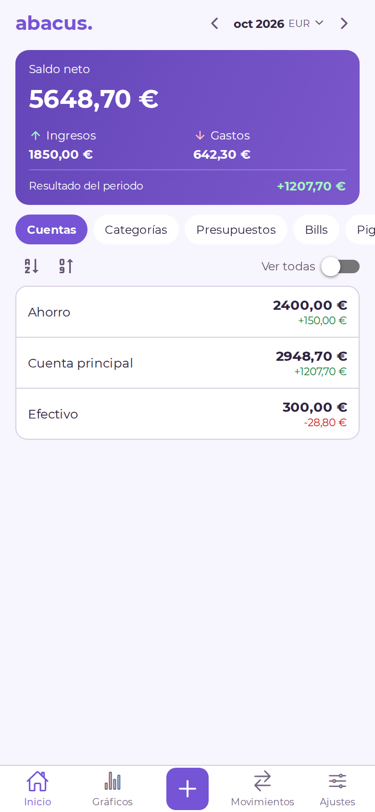
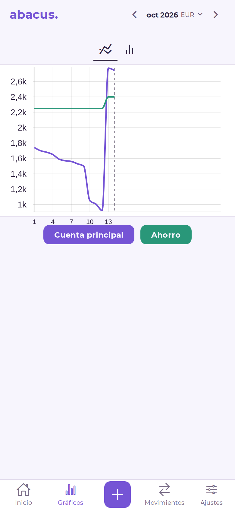
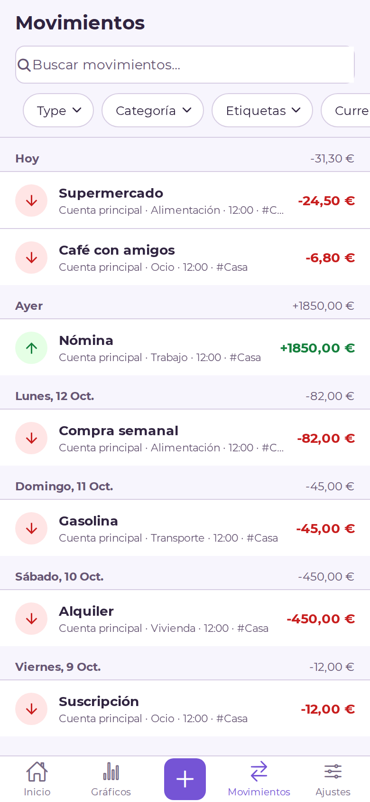
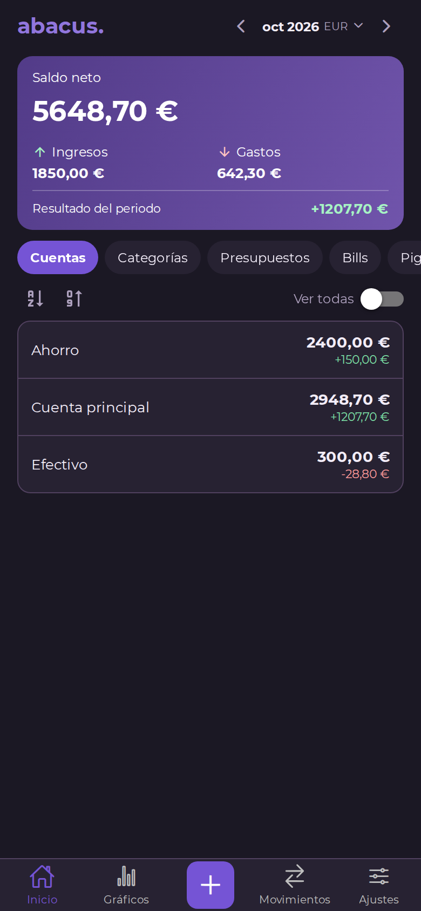
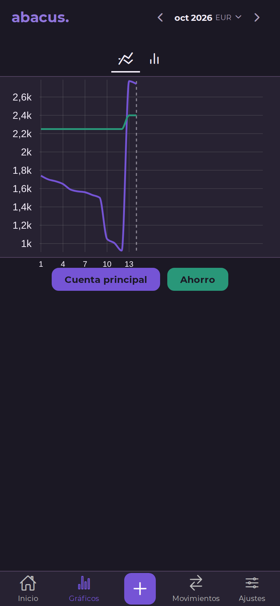
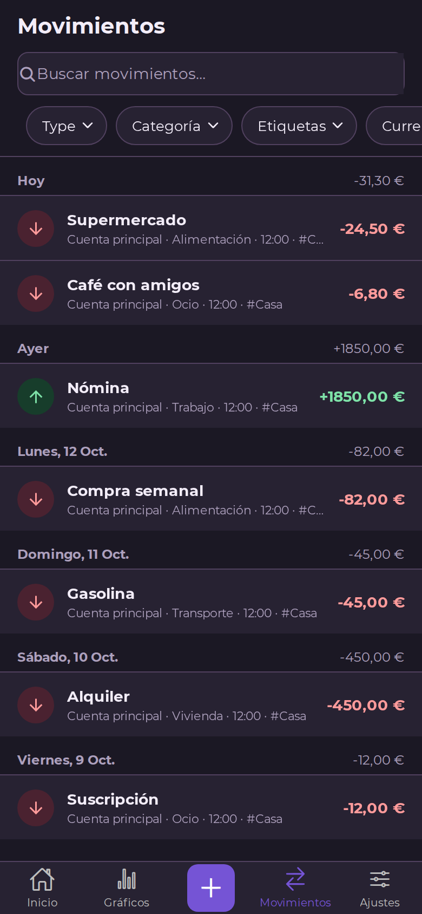

<div align="center">
  
  <h1>Abacus Personal</h1>
  <p>Cliente móvil para tu servidor Firefly III, con la interfaz Perspectiva.</p>
  <p>Fork personal de <a href="https://github.com/victorbalssa/abacus">Abacus, de Victor Balssa</a>.</p>
</div>

Esta versión incorpora una interfaz compacta con acento morado, navegación por Inicio, Gráficos y Movimientos, y un formulario de transacciones revisado. La rama de trabajo es **`personal`**; `develop` se reserva para seguir el proyecto original. Consulta la [organización de las ramas](.github/FORK.md).

## Galería

Inicio, Gráficos y Movimientos en claro y oscuro, generados desde el código de `personal` (referencia `a101691`, versión 0.25.0 / 53). Son previsualizaciones con **React Native Web y datos ficticios**, a 390 × 844 px; el renderizado puede diferir del APK Android. [Procedimiento y alcance de las capturas](scripts/readme/README.md).

<table>
  <tr><th>Inicio · claro</th><th>Gráficos · claro</th><th>Movimientos · claro</th></tr>
  <tr>
    <td></td>
    <td></td>
    <td></td>
  </tr>
  <tr><th>Inicio · oscuro</th><th>Gráficos · oscuro</th><th>Movimientos · oscuro</th></tr>
  <tr>
    <td></td>
    <td></td>
    <td></td>
  </tr>
</table>

## Cambios de esta versión

- Inicio con saldo neto, ingresos, gastos y resultado del periodo; cuentas con saldo cero ocultas salvo al activar «Todas las cuentas».
- Selector de mes, trimestre, semestre y año, compartido con Movimientos.
- Resumen de categorías en Inicio y filtros combinables por categoría y etiqueta en Movimientos.
- Movimientos con cabecera fija, filas compactas, búsqueda y saldo diario al filtrar por cuenta.
- Formulario con detalles visibles, autocompletado, fecha y hora; corrección del cambio entre gasto e ingreso sin cerrar el formulario.
- Apariencia clara, oscura o del sistema y modo privado en Ajustes.
- Caché de determinadas consultas y aviso cuando el servidor no está disponible. No ofrece edición ni sincronización de movimientos sin conexión.

Se conservan la autenticación, edición, duplicación y eliminación de movimientos, transferencias, múltiples partidas, presupuestos, facturas y huchas. La pestaña Gráficos conserva los históricos de cuentas y balance.

## Instalación Android

La app se instala como **Abacus Personal**, con el paquete `io.github.mdaniel592.abacus`, y puede convivir con la aplicación oficial. Requiere tu propia instancia de [Firefly III](https://github.com/firefly-iii/firefly-iii).

La última compilación local documentada es **0.25.0 (53), ARM64**, del 11 de octubre de 2026. Los APK se generan y distribuyen por separado; no están incluidos en Git. Los enlaces de las tiendas del proyecto original corresponden a la app oficial.

Consulta [EXPO.md](EXPO.md) para compilar, instalar y mantener la firma de las actualizaciones. Las actualizaciones OTA están desactivadas. Sigue pendiente la comprobación de esta versión en el móvil con Firefly III real.

## Desarrollo

El proyecto utiliza Expo SDK 54, React Native 0.81 y React 19. Con Node.js 22 y npm:

```sh
npm ci
npm run start
```

`start` utiliza un cliente de desarrollo de Expo. Para compilar y ejecutar en Android o iOS, con sus herramientas nativas instaladas:

```sh
npm run android
# En macOS con Xcode:
npm run ios
```

Comprobaciones del código:

```sh
npm run lint
npm run test:unit
npx tsc --noEmit
```

Para ver el prototipo con datos ficticios sin compilar la app:

```sh
docker compose -f compose.preview.yml up -d
```

Abre [localhost:8095](http://localhost:8095). Los movimientos de la demo viven en memoria y se pierden al recargar; no se envían a Firefly III.

## Documentación y origen

- [Ramas y mantenimiento del fork](.github/FORK.md)
- [Compilación e instalación del APK personal](EXPO.md)
- [Demo de diseño](design/README.md) y [revisión de funciones y límites](design/REVIEW.md)
- [Ayuda de autenticación](.github/HELP.md)
- [Estructura del proyecto](.github/FILE.md) y [guía de contribución original](.github/CONTRIBUTING.md)

Basado en [victorbalssa/abacus](https://github.com/victorbalssa/abacus). Se conserva la licencia [GNU GPL v3](LICENSE) y el reconocimiento a sus autores y colaboradores.
