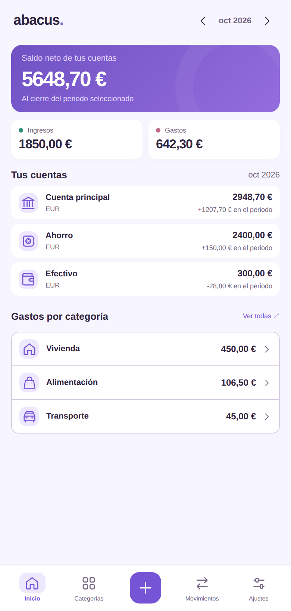
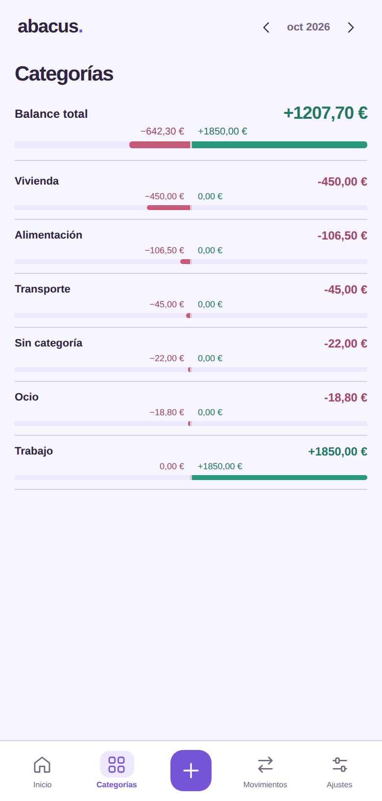
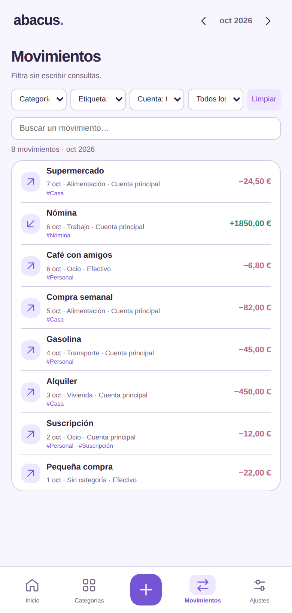
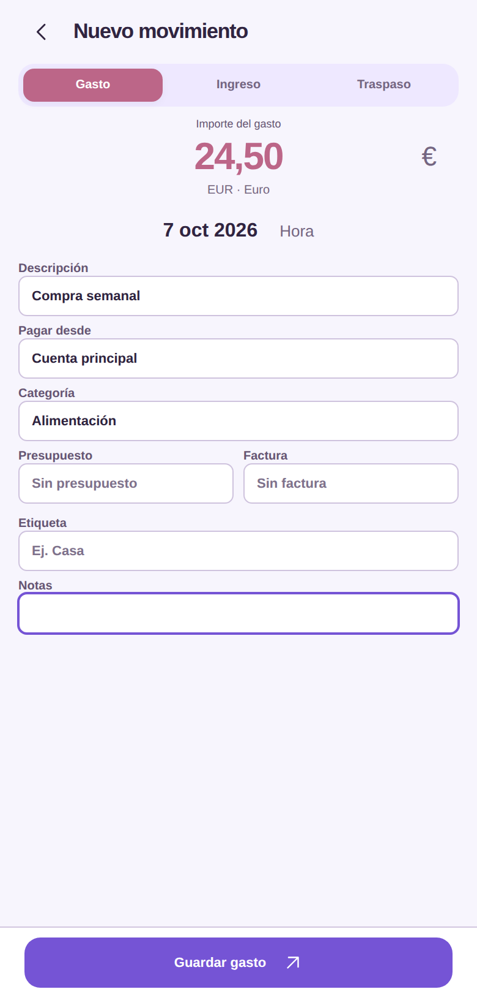
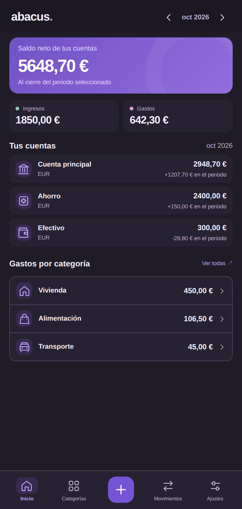
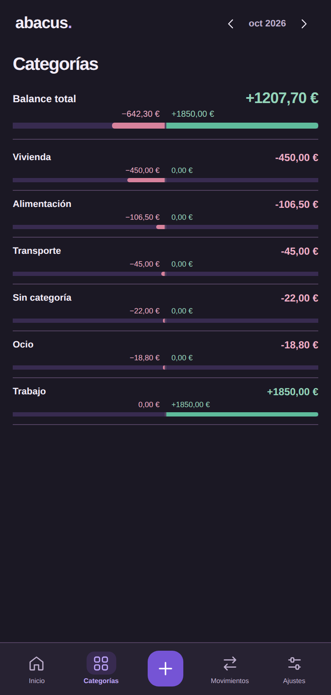

# Demo Perspectiva

Demo interactiva: http://192.168.1.50:8095 (misma red local).

Arrancar o mantener el servidor:

```sh
docker compose -f compose.preview.yml up -d
```

`index.html`, `demo.js` y `demo.css` muestran un prototipo independiente de Perspectiva, desactualizado respecto al APK 53. Incluye balances mensuales por cuenta, categorías con ingresos/gastos/diferencia, filtros combinados por categoría y etiqueta, y creación, edición, duplicación y eliminación de movimientos. El formulario tiene detalles visibles, autocompletado, fecha y hora mediante selectores y colores por tipo.

Los datos son de ejemplo. Los cambios de movimientos viven en memoria hasta recargar la página; no se envían a Firefly III. La demo permite revisar el diseño sin compilar un APK.

`ux-alternatives.html` conserva las cuatro alternativas iniciales.

## Capturas del prototipo web

Estas seis imágenes se generaron el **14 de octubre de 2026** desde `design/index.html`, servido en `http://127.0.0.1:8095/`, con Chromium a 390 × 844 px y escala 2. El último cambio conjunto de los archivos de la demo es el commit `7837c57`, del 7 de octubre de 2026. Se capturó la demo presente en el repositorio en `011e1f9`; no se ejecutó ni capturó el APK.

La demo no tiene un número de versión Android. La aplicación **0.25.0 (53)** mantiene «Gráficos» y sus históricos de cuentas y balance; esta demo muestra «Categorías» en su lugar. Inicio, Movimientos y Ajustes también han recibido cambios nativos posteriores que la demo no reproduce. Por eso estas imágenes se conservan solo como referencia del prototipo.

<table>
  <tr><th>Inicio</th><th>Categorías</th><th>Movimientos</th></tr>
  <tr>
    <td></td>
    <td></td>
    <td></td>
  </tr>
  <tr><th>Nuevo movimiento</th><th>Inicio oscuro</th><th>Categorías oscuras</th></tr>
  <tr>
    <td></td>
    <td></td>
    <td></td>
  </tr>
</table>
